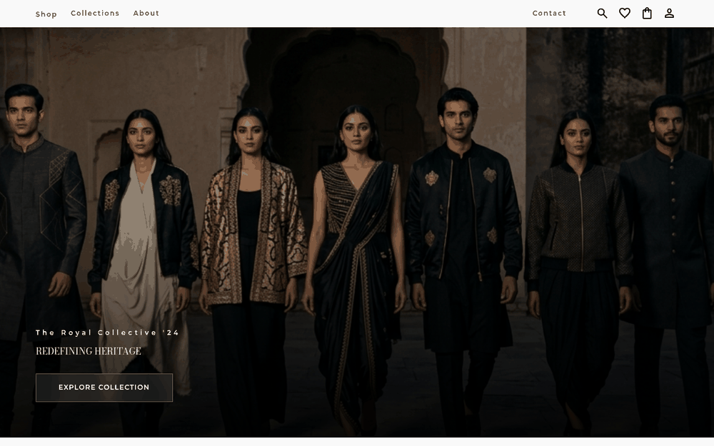
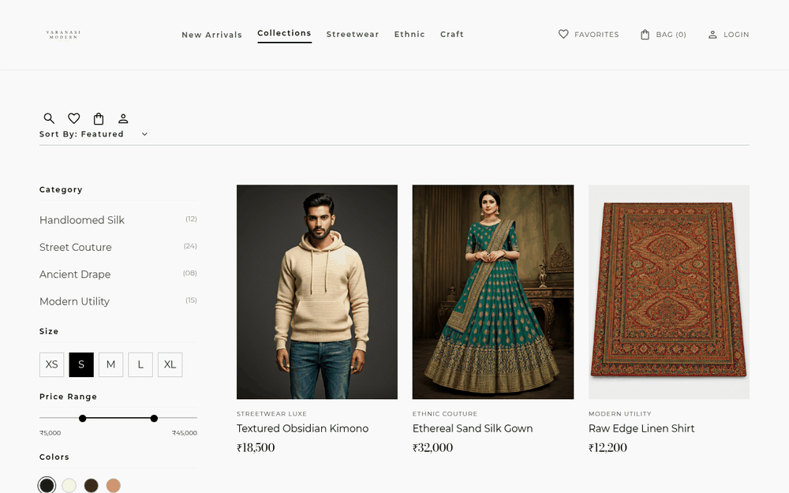
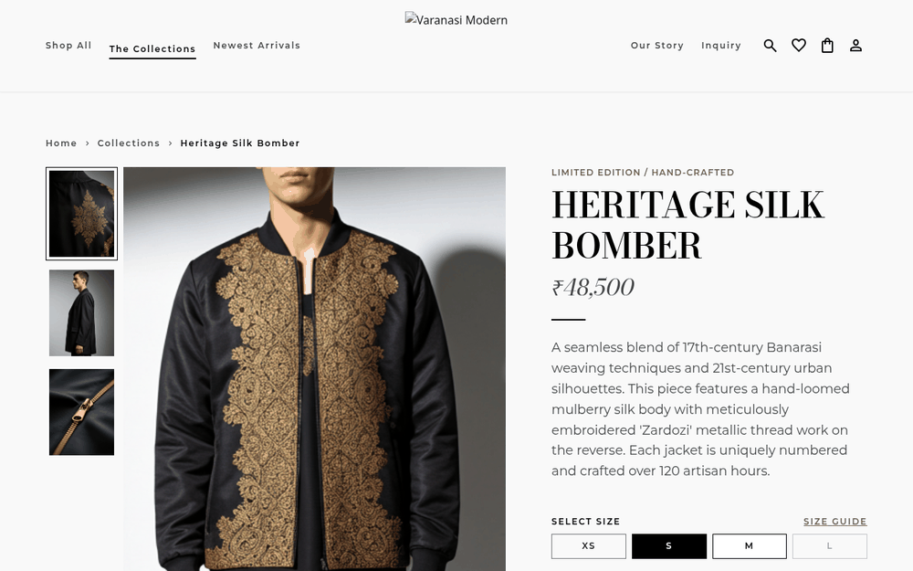
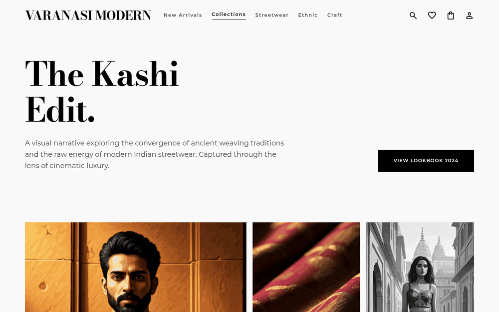

# Stitch — Varanasi Modern

**My first full website project: a multi-page luxury fashion storefront built with HTML, Tailwind CSS and vanilla JavaScript.**

🔗 **Live demo:** [stitch-project-nine.vercel.app](https://stitch-project-nine.vercel.app)




## Features

- **9 pages:** Home, Shop, Product, Lookbook, Cart, Favorites, Sign in, About, Contact and Privacy
- **Shop page** with category, size and price-range filters
- **Product page** with image gallery and size selection
- **Cart and favorites** that persist in the browser (localStorage)
- **Sign-in page** with a demo login state
- **Smooth page transitions** (`transition.js` / `transition.css`)
- **Optional local backend:** `server.py` is a small Python + SQLite API (users, cart, wishlist, orders) for running the site locally
- Responsive layout for mobile and desktop

## Screenshots

<table>
  <tr>
    <td align="center"><br><sub>Shop with filters</sub></td>
    <td align="center"><br><sub>Product page</sub></td>
  </tr>
  <tr>
    <td align="center" colspan="2"><br><sub>Lookbook</sub></td>
  </tr>
</table>

## Tech stack

| Layer | Tools |
|---|---|
| Pages | HTML5 |
| Styling | Tailwind CSS (CDN, forms + container-queries plugins), custom CSS |
| Logic | Vanilla JavaScript (`boutique_core.js`), localStorage |
| Local API (optional) | Python `http.server` + SQLite |
| Hosting | Vercel (also has a GitHub Pages workflow) |

## Getting started

No build step needed.

```bash
git clone https://github.com/navpreet-dev/Stitch-Project.git
cd Stitch-Project
```

- **Quick look:** open `index.html` in your browser.
- **With the local API:** run `python3 server.py` and open [http://localhost:8000](http://localhost:8000).

## How to use the site

1. **Start on Home** — explore the hero and trending collections.
2. **Shop** — filter by category, size or price.
3. **Open a product** — pick a size and add it to your cart.
4. **Save favorites** — tap the heart to keep items for later.
5. **Check the Lookbook** — browse the editorial collection.

## Disclaimer

A learning and portfolio project. Products and prices are samples.

## Author

**Navpreet Singh**

- GitHub: [@navpreet-dev](https://github.com/navpreet-dev)
- LinkedIn: [navpreetsingh-dev](https://www.linkedin.com/in/navpreetsingh-dev)

If you like this project, a ⭐ on the repo is appreciated.
